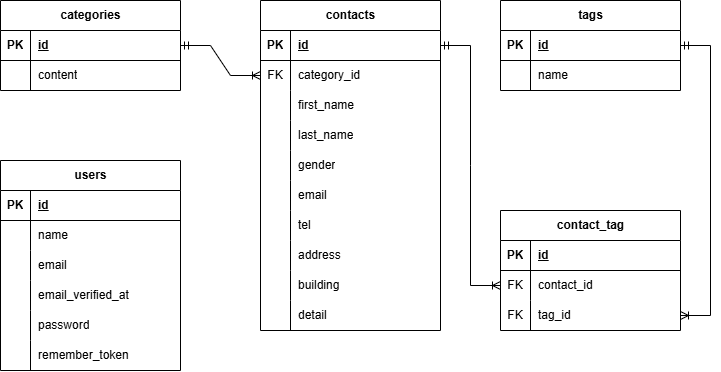

# COACHTECH お問い合わせ管理
### 概要
本システムは、一般ユーザーが誰でもお問い合わせを送信でき、管理者がその内容を確認・管理するWebシステムです。
#### 主な機能概要
- **一般ユーザー向け機能**:
  - お問い合わせ送信
- **管理者向け機能**:
  - 管理者認証機能（ログイン / ログアウト / 新規登録）
  - お問い合わせ一覧表示（ペジネーション・検索フィルター付き）・詳細確認・削除
  - お問い合わせデータのCSVエクスポート（ダウンロード機能）
  - タグ追加・更新・削除
- **公開API機能**:
  - お問い合わせ一覧取得（ペジネーション・検索フィルター付き）・詳細取得・新規登録・更新・削除

---

### ER図
プロジェクト内のデータベース設計図です。


### 環境構築手順
ターミナルを開き、以下の手順で環境を構築してください。
※Windowsの方へ：WSL（Ubuntu）のターミナルで実行してください（PowerShellでは動きません）。
#### 前提条件
- **Docker Desktop** がインストールされ、起動していること
- **Git** が利用可能であること

#### 1. プロジェクトをクローン
プロジェクトをローカルにダウンロードします。
```bash
git clone https://github.com/kikukawa-hiromi/contact-form-app.git contact-form-app
```
#### 2. プロジェクトディレクトリに移動
```bash
cd contact-form-app
```
#### 3. 環境変数ファイルを作成
.env.exampleファイルを、.envファイルにコピーします。
```bash
cp .env.example .env
```
#### 4. Composerパッケージをインストール
Dockerを使用してComposerパッケージをインストールします。
```bash
docker run --rm \
    -u "$(id -u):$(id -g)" \
    -v "$(pwd):/var/www/html" \
    -w /var/www/html \
    -e COMPOSER_CACHE_DIR=/tmp/composer_cache \
    laravelsail/php82-composer:latest \
    composer install
```
#### 5. Laravel Sailをインストール
```bash
docker run --rm \
    -u "$(id -u):$(id -g)" \
    -v "$(pwd):/var/www/html" \
    -w /var/www/html \
    -e COMPOSER_CACHE_DIR=/tmp/composer_cache \
    laravelsail/php82-composer:latest \
    composer require laravel/sail --dev
```
#### 6. Sailの設定ファイルをパブリッシュ（MySQLを選択）
```bash
docker run --rm \
    -u "$(id -u):$(id -g)" \
    -v "$(pwd):/var/www/html" \
    -w /var/www/html \
    -e COMPOSER_CACHE_DIR=/tmp/composer_cache \
    laravelsail/php82-composer:latest \
    php artisan sail:install --with=mysql
```
#### 7. 環境変数ファイルの確認
.env ファイルを開き、データベース接続情報が以下と一致していることを確認します。
```bash
DB_CONNECTION=mysql
DB_HOST=mysql
DB_PORT=3306
DB_DATABASE=laravel
DB_USERNAME=sail
DB_PASSWORD=password
```
#### 8. Docker環境を起動
コンテナを起動します。初回はイメージのビルドに数分かかる場合があります。
```bash
./vendor/bin/sail up -d
```
#### 9. アプリケーションキーを生成
Laravelの暗号化キーを生成します。
```bash
./vendor/bin/sail artisan key:generate
```
#### 10. データベースの準備
テーブルを作成し、テストデータを投入します。
```bash
./vendor/bin/sail artisan migrate:fresh --seed
```
#### 11. NPM依存パッケージのインストール
```bash
sail npm install
```
#### 12. Vite開発サーバーの起動
注意: sail npm run dev は実行したままにしておく必要があります。
```bash
sail npm run dev
```
### 使用技術
- バックエンド: PHP 8.2 / Laravel 10.0
- データベース: MySQL 8.0
- 開発環境: Docker / Laravel Sail
- フロントエンド: Blade, Tailwind CSS, Vite
- コード整形・テスト: Laravel Pint, PHPUnit
- ソース管理: Git, GitHub
### API エンドポイント一覧

ベースURL: `/api/v1`

| メソッド | パス | 処理概要 |
| :--- | :--- | :--- |
| `GET` | `/api/v1/contacts` | お問い合わせ一覧を取得 |
| `POST` | `/api/v1/contacts` | お問い合わせを新規登録 |
| `GET` | `/api/v1/contacts/{contact}` | お問い合わせ詳細を取得 |
| `PUT` | `/api/v1/contacts/{contact}` | お問い合わせ情報を更新 |
| `DELETE` | `/api/v1/contacts/{contact}` | お問い合わせを削除 |
### 開発環境URL
- Webアプリケーション: http://localhost
- DB管理 (phpMyAdmin): http://localhost:8080
### 作成者
菊川　裕美